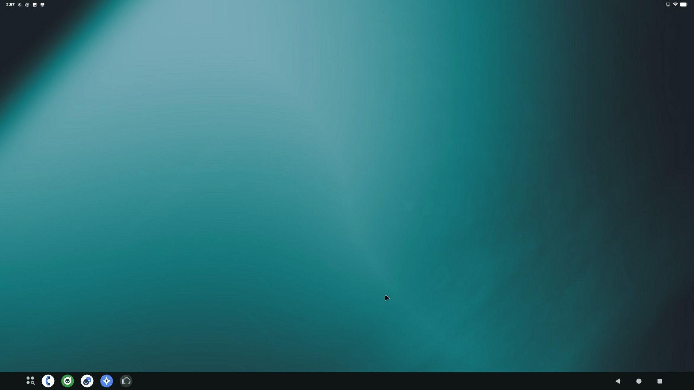

# Pixel 8 → Android Desktop "mini PC" (broken screen, no touch input)

Turn a Google Pixel 8 (`shiba`) with a dead/broken display into an Android
desktop box that runs on an external monitor over USB‑C DisplayPort, installed
**entirely from a PC** — no taps on the phone.

Stack: **LineageOS 23.2 (Android 16)** + **MindTheGapps 16** + **Magisk 31.1**
with a first‑boot overlay that enables ADB, desktop mode and darkens the
internal panel.

> **Status (2026‑11‑10): working.** Android 16 desktop mode (taskbar + freeform
> windows) at 1920×1080 on a Dell P2214H through a USB‑C AV adapter, with a USB
> keyboard/mouse on the adapter. See [Progress log](#progress-log).



## What finally worked

| Piece | What it does |
|---|---|
| `vbmeta` flashed with `--disable-verity --disable-verification` | `system_ext`/`product` are modified, so dm‑verity has to be off (needs a data format afterwards) |
| Magisk‑patched `init_boot` | root + Magisk modules |
| `system_ext` with `extdisplay/hardcode/` baked in | init service that runs `extdisplay.sh` every boot, even without Magisk |
| Magisk module `extdisplay/magisk-module/pixel8-extdisplay` | same script as a module; **Action** button toggles mirror ↔ desktop |
| `extdisplay/core/extdisplay.sh` | USB debugging on + PC key trusted, no lock screen, stay awake on power, mirror or desktop mode, wakes the phone and **auto‑approves the "Mirror to external display?" dialog** (via `uiautomator`) when a monitor is plugged in |

Lessons:
- The Pixel 8 kernel + LineageOS 23.2 already drive DP Alt Mode; no custom ROM build is needed.
- If the monitor stays dark, **flip/replug the USB‑C plug** (adapter powered first) —
  Alt Mode sometimes doesn't negotiate on the first plug. Check with
  `adb shell dumpsys usb | grep DisplayPortAltModeInfo`.
- After `fastboot -w`, format `/data` from recovery with Android's f2fs features
  (`make_f2fs -g android -O project_quota,extra_attr -O casefold -C utf8 -O compression`);
  a plain host‑side format leaves the phone unbootable.
- Once it boots: pair **Wireless debugging** so the phone can be managed while it sits on the dock.
- Put your own `~/.android/adbkey.pub` in the module/overlay as `adb_keys` before building (not included in this repo).

---

## Hardware

| Item | Notes |
|---|---|
| Pixel 8 (`shiba`), bootloader **unlocked** | Tensor G3, supports DP Alt Mode out of USB‑C |
| USB‑C hub with **DisplayPort Alt Mode** + power passthrough | DisplayLink docks do **not** work |
| Monitor, USB keyboard + mouse | |
| Linux PC with `adb`/`fastboot` (platform‑tools 35+), `python3`, `mkbootimg`/`unpack_bootimg` | |
| **Wall charger** | Charging from a PC port (~175 mA) barely keeps up during recovery — the phone dropped off USB twice |

## Files used

| File | Source |
|---|---|
| `lineage-23.2-20261004-nightly-shiba-signed.zip` + `boot/dtbo/vendor_boot/vendor_kernel_boot/init_boot.img` | download.lineageos.org (`/api/v2/devices/shiba/builds`) — sha256 verified |
| `MindTheGapps-16.0.0-arm64-20261023_034858.zip` | github.com/MindTheGapps/16.0.0-arm64 — sha256 verified |
| `Magisk-v31.1.apk` | github.com/topjohnwu/Magisk releases |

Firmware: the phone's stock **Android 16** bootloader/modem
(`ripcurrent-16.4-14097582`, `g5300i-250909-251024`) is kept. LineageOS 23.2
requires Android 16 firmware, and *not* touching bootloader partitions avoids the
only real brick risk.

---

## Why a no‑input install is hard (lessons learned)

1. **Lineage Recovery only draws on the internal panel.** It never mirrors to
   USB‑C display, so every recovery menu is blind.
2. **Recovery ADB is "unauthorized" by default.** Fix: bake the PC's
   `~/.android/adbkey.pub` into the recovery ramdisk as `/adb_keys`
   (`scripts/mkfrag.py` adds it as an extra vendor‑ramdisk fragment, no need to
   recompress the original). Result: root `adb shell` in recovery.
3. **Do NOT use `adb reboot sideload` + `adb sideload` for the ROM.** On this
   phone the A/B payload stream stalled at 32 %, 38 % and 47 % (45+ min), and
   `adb reboot sideload` writes a **BCB "boot into sideload" flag** to `misc`
   that survives reboots — the phone kept coming back into sideload mode and
   ignored both `adb reboot bootloader` and button combos.
   **Escape:** `adb reboot fastboot` from sideload mode overwrites the BCB with
   `--fastboot` and lands in **fastbootd**.
4. **Better path: extract `payload.bin` on the PC and flash with fastboot.**
   `scripts/payload_dump.py` (pure Python; REPLACE / REPLACE_XZ / REPLACE_BZ /
   ZSTD / ZERO ops) extracts all 26 images and every one is verified against the
   SHA‑256 in the payload manifest.

---

## Install procedure (the one that works)

### 0. Download + verify
```bash
mkdir -p ~/Downloads/pixel8-lineage/a16 && cd $_
curl -s https://download.lineageos.org/api/v2/devices/shiba/builds  # pick the 23.2 build
# download zip + boot.img dtbo.img vendor_boot.img vendor_kernel_boot.img init_boot.img
sha256sum -c sums
```

### 1. Extract the OTA payload
```bash
python3 -I scripts/payload_dump.py lineage-23.2-*-shiba-signed.zip payload/
```

### 2. Recovery that trusts this PC
```bash
unpack_bootimg --boot_img vendor_boot.img --out vb --format mkbootimg > args.txt
python3 -I scripts/mkfrag.py ~/.android/adbkey.pub adbfrag.lz4
eval mkbootimg $(cat args.txt) --ramdisk_type 1 --ramdisk_name adbkey \
     --vendor_ramdisk_fragment adbfrag.lz4 --vendor_boot vendor_boot_adb.img
```

### 3. Magisk‑patched init_boot with first‑boot overlay
Patch on the PC using the x86_64 `magiskboot` from the APK:
```bash
unzip -j Magisk.apk 'lib/arm64-v8a/*' assets/boot_patch.sh assets/util_functions.sh
# rename libX.so -> X ; take lib/x86_64/libmagiskboot.so as ./magiskboot
KEEPVERITY=true KEEPFORCEENCRYPT=true sh boot_patch.sh init_boot.img   # -> new-boot.img
./magiskboot unpack new-boot.img
./magiskboot cpio ramdisk.cpio \
  "add 0644 overlay.d/firstboot.rc magisk-overlay/overlay.d/firstboot.rc" \
  "add 0755 overlay.d/sbin/firstboot.sh magisk-overlay/overlay.d/sbin/firstboot.sh" \
  "add 0644 overlay.d/sbin/adb_keys ~/.android/adbkey.pub"
./magiskboot repack new-boot.img init_boot_magisk_desktop.img
```
`magisk-overlay/` on first boot: installs the PC key, turns on USB debugging,
forces desktop mode on external displays, freeform windows, stay‑awake on
charge, internal panel brightness 1 / 15 s timeout, lock screen off.

### 4. Flash (one fastboot session) — `scripts/flash.sh`
Bootloader: `boot dtbo vendor_kernel_boot vendor_boot(adb) init_boot(magisk) pvmfw vbmeta vbmeta_system vbmeta_vendor` → slot **a**.
Then `fastboot reboot fastboot` (fastbootd): `snapshot-update cancel`, flash
`system system_ext product vendor vendor_dlkm system_dlkm`, `fastboot -w`,
`erase misc` (clears the sideload BCB), `reboot recovery`.

### 5. GApps (recovery, authorized adb)
```bash
adb reboot sideload && adb sideload MindTheGapps-16.0.0-arm64-*.zip
```
*(GApps must go in before first boot.)*

### 6. First boot → plug in the monitor → desktop.

---

## Using it

- Plug the hub (DP Alt Mode) → monitor shows the desktop; the phone panel stays dark.
- Control from the PC: `scrcpy` (mirror/keyboard/mouse), `adb shell`.
- Settings applied by the overlay are in `magisk-overlay/overlay.d/sbin/firstboot.sh`;
  log on device at `/data/local/tmp/firstboot.log`.

---

## Progress log

| # | Event (2026‑11‑09) |
|---|---|
| 1 | Phone in fastboot: `shiba`, unlocked, bootloader `ripcurrent-16.4` (Android 16 firmware) |
| 2 | Flashed LineageOS **24.0** boot images — wrong choice (needs Android 17 firmware) |
| 3 | Switched to LineageOS **23.2** (Android 16) + MindTheGapps 16 |
| 4 | Built `vendor_boot_adb.img` (recovery trusts PC key) → root shell in recovery ✅ |
| 5 | `adb sideload` ROM — stalled at 32 %; phone then dropped off USB (likely low battery) |
| 6 | Magisk 31.1 init_boot patched on PC + desktop overlay added |
| 7 | 2nd/3rd sideload stalled at 38 % / 47 % (~45 min) |
| 8 | Extracted payload on PC, 26/26 images hash‑verified; wrote `flash.sh` |
| 9 | Phone trapped in sideload by BCB; `adb reboot fastboot` sent to escape into fastbootd |
| 10 | fastbootd: `wipe-super`, flashed all logical partitions; `system_ext` baked with adb key + `zz-desktop.rc`, `product` with GApps; data wiped |
| 11 | Android boots (charging sound, TalkBack works) but USB shows MTP (`18d1:4ee1`) for ~6 s ~20 s after reboot, then drops — adb never appears |
| 12 | Added root boot script (`pixel8-desktop.sh`, `seclabel u:r:su:s0`, Lineage is userdebug) to force adb + DP + desktop mode + skip setup; reflashed `system_ext` only — same USB drop |
| 13 | Next: pull kernel/init log (pstore) from recovery to see why the USB gadget drops |
| 14 | 2026‑11‑10: suspected cause of the USB drop — `system_ext`/`product` were modified with stock `vbmeta` (dm‑verity on) |
| 15 | Built `extdisplay/`: core script (DP on, mirror phone → monitor, ADB, no lock, wake on plug‑in), Magisk module zip, Magisk init_boot overlay that installs it, hard‑coded `system_ext_v3`; `flash-extdisplay.sh` = logs → vbmeta verity off → init_boot → system_ext → wipe → boot |
| 16 | **Working:** desktop mode on a DELL P2214H (1920×1080) via a USB‑C AV adapter. Combo: vbmeta verity off, old Magisk init_boot, `system_ext_v3`, Magisk module. Tip: if the monitor stays dark, flip/replug the USB‑C cable (adapter power first) — DP alt mode didn't negotiate on the first plug |
